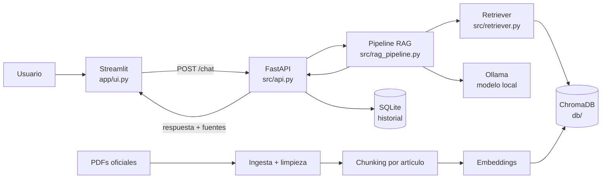

# Arquitectura — Mini-Juztina

## Vista general

## Componentes y responsabilidades

| Capa | Componente | Responsabilidad |
|---|---|---|
| Datos | `src/ingest.py` | PDF → texto limpio y normalizado. |
| Datos | `src/chunker.py` | Detectar Título, Capítulo y Artículo; un artículo por chunk con metadatos. |
| Datos | `src/build_subchunks.py` | Fragmentar artículos largos por inciso, conservando `parent_id`, para mejorar el embedding. |
| Índice | `src/embedder.py` | Vectorizar chunks con `multilingual-e5-base` y persistir en ChromaDB (`legislacion_pe` y `legislacion_pe_sub`). |
| Recuperación | `src/retriever.py` | `retrieve(query, k=5)` híbrido: busca subchunks, agrupa por artículo y devuelve el texto completo con metadatos. |
| Generación | `src/rag_pipeline.py` | Contexto → prompt → Ollama → respuesta estructurada con fuentes. |
| API | `src/api.py` | `POST /chat`, `GET /health`; valida entradas y orquesta el pipeline. |
| Persistencia | SQLite | Historial por sesión, últimos N turnos. |
| Presentación | `app/ui.py` | Chat, estados y panel de transparencia. |
| Configuración | `DECISIONS.md`, `prompts/` | Decisiones, modelo y guardrails versionados. |

## Flujo de una consulta

1. La UI envía `{mensaje, sesion_id}` a `POST /chat`.
2. La API recupera los últimos N turnos de la sesión.
3. El pipeline aplica el guardrail léxico de alcance; si el tema es laboral,
   civil o tributario evidente, responde sin retrieval ni LLM.
4. El retriever busca en `legislacion_pe_sub`, agrupa por `parent_id` y recupera el artículo completo desde `legislacion_pe`.
5. El pipeline arma el prompt con el system prompt + contexto comprimido + pregunta.
6. Ollama genera la respuesta con `temperature=0.2` citando `[S1]`, `[S2]`, `[S3]`.
7. El pipeline reemplaza los identificadores por `(Documento, Artículo N)`, valida citas y adjunta las fuentes.
8. La API devuelve `{respuesta, fuentes, en_alcance, motivo, citas_invalidas, requiere_revision, modo, latencia_s}` y guarda el turno.
9. La UI muestra la respuesta y el panel de transparencia.

## Principios de diseño

- **Separación de responsabilidades:** ingesta, recuperación, generación y presentación no se mezclan.
- **Trazabilidad:** cada cita se vincula a un `id` de chunk existente.
- **Local-first:** ningún componente requiere red en tiempo de ejecución.
- **Fallar de forma segura:** ante falta de sustento o error del LLM, se informa en lugar de inventar.
- **Configuración explícita:** rutas, modelo, `k`, `temperature` y `num_ctx` viven en configuración, no dispersos en el código.

## Contratos entre capas

- Chunk JSONL: ver `equipo/DIVISION_TRABAJO.md` (sección 1).
- `retrieve()`: devuelve `id`, `texto`, `metadatos`, `score`, `score_semantico`, `distancia` y `match_id` (subchunk que originó la coincidencia).
- API: ver `equipo/DIVISION_TRABAJO.md` (sección 3).

## Buenas prácticas del repositorio

- Funciones pequeñas y con type hints; docstrings en módulos públicos.
- Manejo explícito de errores (Ollama caído, índice vacío, PDF inválido) con mensajes claros.
- Sin secretos ni rutas absolutas; usar rutas relativas a la raíz del proyecto.
- Pruebas en `tests/` y reportes versionados.
- Commits atómicos con prefijo (`feat`, `fix`, `docs`, `test`, `refactor`).
